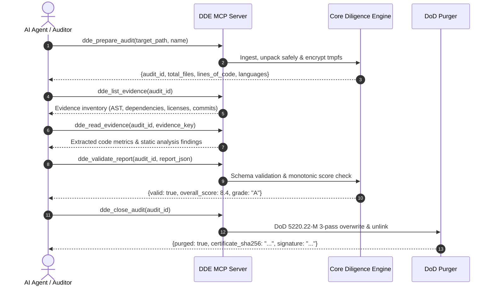

# Skill: dde-audit (Repository Audit via Native MCP Server)

This skill instructs any AI agent on conducting an end-to-end, bank-grade software due diligence audit using Due Diligence Engine's native MCP tools.

---

## 1. Prerequisites & Starting MCP Server

To start the native Model Context Protocol (MCP) server for Due Diligence Engine:
```bash
python3 -m due_diligence_engine.cli mcp
# or via entrypoint:
dde mcp
```

The MCP server runs over standard I/O (stdio) and provides JSON-RPC 2.0 tool and resource endpoints.

---

## 2. Standard Audit Tool Lifecycle

Follow this exact sequence to ensure strict security isolation and cryptographic cleanup:



### Step 1: Prepare Audit (`dde_prepare_audit`)
- **Parameters**:
  - `target_path` (string, required): Local directory or repository path to inspect.
  - `name` (string, optional): Project name.
  - `max_files` (integer, optional): Maximum files to ingest (default: 5000).
- **Behavior**:
  - Ingests repository safely (blocking Zip Slip, symlink escapes, FIFOs).
  - Initializes ephemeral memory-backed storage with `0o700` POSIX permissions.
  - Returns `audit_id`.

### Step 2: List Evidence (`dde_list_evidence`)
- **Parameters**:
  - `audit_id` (string, required): The active audit session ID.
- **Behavior**:
  - Surfaces available evidence files: AST metadata, dependency manifests (`package.json`, `pyproject.toml`, `Cargo.toml`), git commit statistics, and cyclomatic complexity distributions.

### Step 3: Read Evidence (`dde_read_evidence`)
- **Parameters**:
  - `audit_id` (string, required): Active audit ID.
  - `evidence_key` (string, required): Specific evidence item to inspect.
- **Behavior**:
  - Returns extracted metrics, vulnerability alerts, and filtered code samples without executing target code.

### Step 4: Validate Report (`dde_validate_report`)
- **Parameters**:
  - `audit_id` (string, required): Active audit ID.
  - `report_data` (object, required): Full JSON structure adhering to the 9-dimension consulting schema.
- **Behavior**:
  - Validates dimension scores (`1.0` - `10.0`), weights, red flag criteria, and investment recommendations.

### Step 5: Close Audit & Cryptographic Purge (`dde_close_audit`)
- **Parameters**:
  - `audit_id` (string, required): Audit session to terminate.
- **Behavior**:
  - Executes DoD 5220.22-M 3-pass overwrite (`0x00`, `0xFF`, `urandom`) on all temporary files.
  - Signs and emits an ECDSA P-256 purge certificate.

---

## 3. CLI Direct Fallback

If running standalone without an active MCP client:
```bash
# Ingest and generate consulting prompt
dde prompt /path/to/repo --pdf --lang en --output /tmp/prompt.txt

# Run full score analysis
dde audit /path/to/repo --output-dir /tmp/dde_output

# Trigger manual purge of audit artifacts
dde purge --target /tmp/dde_output
```
