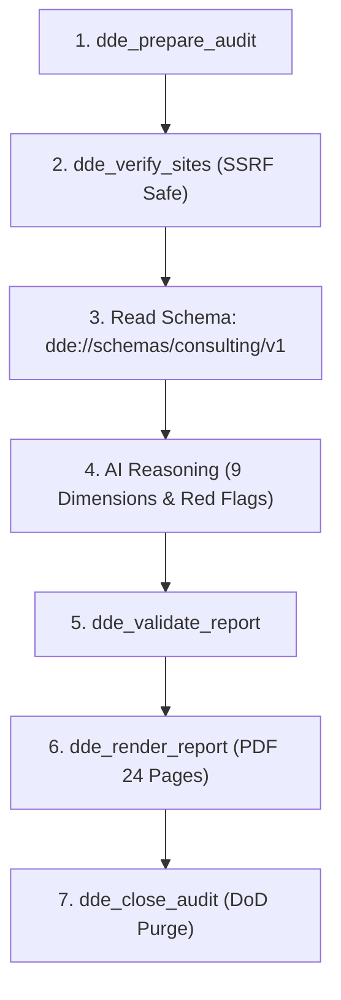

# Skill: dde-consulting-report (24-Page M&A Consulting Report)

This skill provides step-by-step guidance for an AI agent to produce an institutional-grade, 24-page M&A consulting PDF report in any of the 14 supported languages.

---

## 1. Supported Languages & Locales

The generator natively formats typography, currency symbols, and localized terminology across 14 languages:
- `en` (English - default)
- `ja` (Japanese)
- `es` (Spanish)
- `fr` (French)
- `de` (German)
- `zh` (Chinese)
- `ko` (Korean)
- `pt` (Portuguese)
- `it` (Italian)
- `ru` (Russian)
- `nl` (Dutch)
- `ar` (Arabic - RTL shaped)
- `vi` (Vietnamese - diacritics)
- `th` (Thai - stacked tonemarks)

---

## 2. MCP Consulting Report Workflow



### Step 1: Initialize Audit (`dde_prepare_audit`)
```json
{
  "target_path": "/path/to/target/repository",
  "name": "TargetAcquisitionCorp"
}
```

### Step 2: Live Infrastructure & Site Verification (`dde_verify_sites`)
- Validates live SaaS URLs, APIs, and SSL/TLS certificates without exposing internal networks (RFC 6598 & private IP ranges are blocked via `ip.is_global`).
```json
{
  "audit_id": "<audit_id>",
  "urls": ["https://app.targetcorp.com", "https://api.targetcorp.com/health"]
}
```

### Step 3: Read Consulting Schema
- Read the static resource `dde://schemas/consulting/v1` to obtain the exact JSON schema definition for the 9 dimensions:
  1. `architecture`: Architectural elegance & modularity (15%)
  2. `code_quality`: Static analysis, complexity, linting (15%)
  3. `security`: Vulnerabilities, secrets, dependency CVEs (15%)
  4. `scalability`: Concurrency, caching, database design (10%)
  5. `infrastructure`: CI/CD, IaC, containerization, observability (10%)
  6. `test_coverage`: Unit, integration, automated coverage (10%)
  7. `documentation`: API docs, onboarding, architectural diagrams (5%)
  8. `team_maintainability`: Bus factor, commit cadence, contributor dispersion (10%)
  9. `operational_risk`: Licenses, compliance, legal, vendor lock-in (10%)

### Step 4: AI Model Evaluation
- Synthesize all findings and compute score weights, qualitative justifications, and verified red flags.
- Apply the **Zero False Positive Principle**: Discard ungrounded heuristics; only report actionable, code-proven defects.

### Step 5: Validate Report (`dde_validate_report`)
- Check schema compliance, monotonicity, and mathematical score consistency:
```json
{
  "audit_id": "<audit_id>",
  "report_data": {
    "project_name": "TargetAcquisitionCorp",
    "evaluation_date": "2026-11-01",
    "overall_score": 8.5,
    "grade": "A",
    "recommendation": "PROCEED_WITH_CONDITIONS",
    "dimensions": { ... },
    "red_flags": [ ... ]
  }
}
```

### Step 6: Render 24-Page PDF (`dde_render_report`)
- Call `dde_render_report` specifying target language:
```json
{
  "audit_id": "<audit_id>",
  "format": "pdf",
  "lang": "ja",
  "output_path": "/path/to/target_report_ja.pdf"
}
```
- The generator executes ReportLab 5.1 layout composition, RTL shaping (for `ar`), and custom cover page styling.

### Step 7: Close & Purge (`dde_close_audit`)
- Destroy all intermediate evidence and issue non-repudiable purge certificate.
